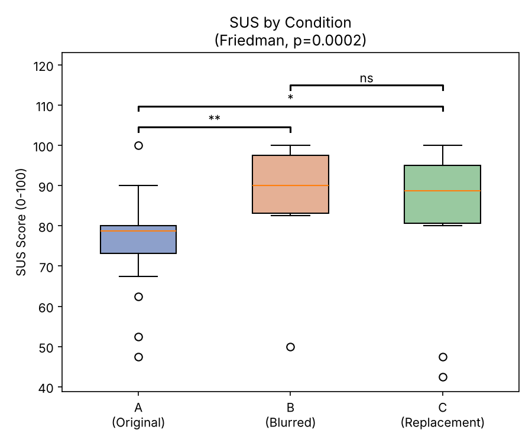
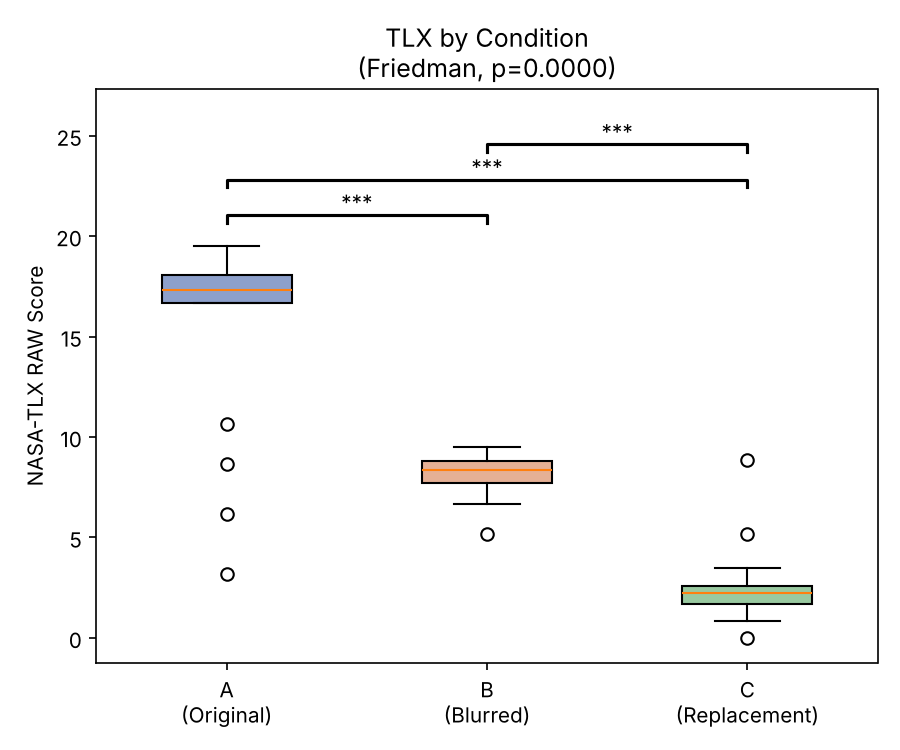
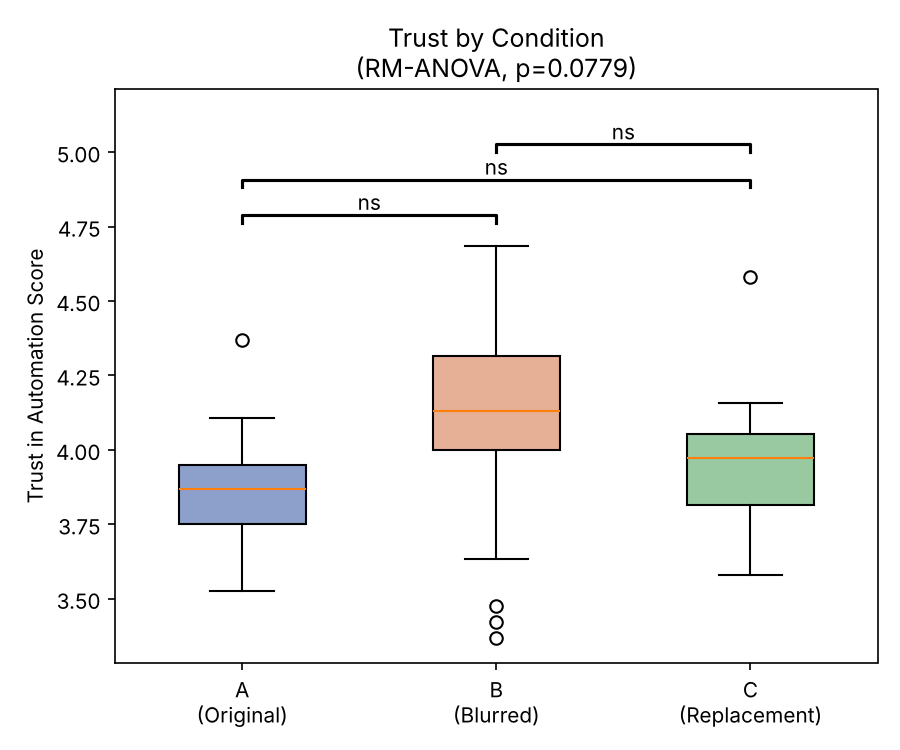
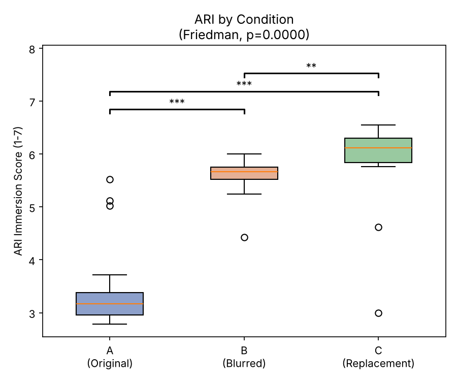
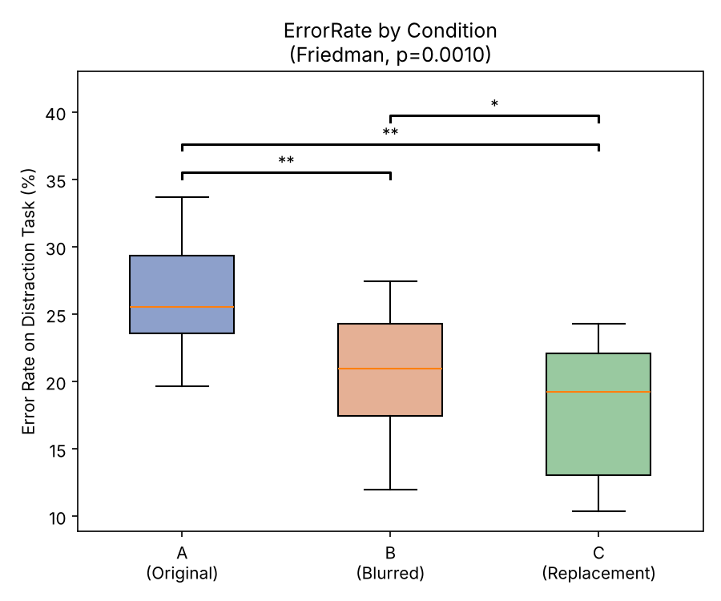

# User Study

Evaluation of the AR advertisement detection & replacement app: does blurring or replacing real-world advertisements change usability, workload, trust, immersion and distraction?

Final presentation: [`presentation/AR_Presentation_final.pdf`](presentation/AR_Presentation_final.pdf) (slides 7–13 cover the study).

## Study design

| | |
|---|---|
| Design | Within-subject, every participant experienced all three conditions |
| Participants | N = 18 (convenience sample) |
| Conditions | **A** Original advertisements · **B** Blurred advertisements · **C** Advertisements replaced by a relaxing beach video |
| Device | Meta Quest 3, passthrough mixed reality |
| Task | Paper-based number-finding task done with the headset on (3 minutes per condition: mark all numbers between 30 and 70 in a grid, different grid per condition) while the advertisement is in view |
| Survey tool | LimeSurvey |

### Measures (after each condition)

| Measure | Instrument | Scale | Scoring |
|---|---|---|---|
| Usability | System Usability Scale (SUS), 10 items | 1–5 | Standard SUS score 0–100 |
| Workload | NASA-TLX (raw), 6 subscales | 0–20 | Mean of the 6 subscales; *Performance* reversed (20 − x) |
| Trust | Trust in Automation, 19 items | 1–5 | Mean; items SQ005, SQ007, SQ012, SQ015, SQ016 reversed |
| Immersion | Augmented Reality Immersion (ARI), 42 items | 1–7 | Mean; items SQ011, SQ012, SQ014, SQ017, SQ019 reversed |
| Distraction | Error rate on the number task | % | incorrect / (correct + incorrect) × 100 |

Demographics (age, gender, AR experience) were collected once at the start, and preference/feedback questions once at the end.

## Statistical approach

1. Compute one score per participant, condition and measure.
2. **Shapiro-Wilk** test for each condition separately.
3. Normal in all three conditions → **one-way repeated-measures ANOVA** (Trust).
   Not normal in at least one → **Friedman test** (SUS, TLX, ARI, error rate).
4. Post-hoc: **paired t-tests** (after ANOVA) or **Wilcoxon signed-rank tests** (after Friedman), **Holm-corrected**.

α = 0.05 · Significance: \* p < .05, \*\* p < .01, \*\*\* p < .001 (Holm-corrected).

## Results

| Measure | A Original M (SD) | B Blurred M (SD) | C Replacement M (SD) | Test | p |
|---|---|---|---|---|---|
| SUS (0–100, higher = better) | 75.97 (12.61) | 88.33 (11.38) | 85.56 (16.35) | Friedman χ² = 17.07 | **0.0002** |
| NASA-TLX (lower = less workload) | 15.46 (4.84) | 8.15 (1.03) | 2.49 (1.93) | Friedman χ² = 26.78 | **< 0.0001** |
| Trust in Automation (1–5) | 3.87 (0.19) | 4.07 (0.38) | 3.97 (0.22) | RM-ANOVA F = 2.75 | 0.0779 |
| ARI immersion (1–7) | 3.47 (0.84) | 5.59 (0.35) | 5.89 (0.84) | Friedman χ² = 23.44 | **< 0.0001** |
| Error rate (%) | 25.94 (4.14) | 21.00 (4.44) | 17.86 (5.09) | Friedman χ² = 13.78 | **0.0010** |

Post-hoc comparisons (Holm-corrected):

| Measure | A vs B | A vs C | B vs C |
|---|---|---|---|
| SUS | \*\* | \* | ns |
| NASA-TLX | \*\*\* | \*\*\* | \*\*\* |
| Trust | ns | ns | ns |
| ARI | \*\*\* | \*\*\* | \*\* |
| Error rate | \*\* | \*\* | \* |

**In short:** Both blurring and replacing advertisements improved usability and immersion and reduced workload and errors compared with the original advertisements. The relaxing video (C) gave the lowest workload, the highest immersion and the fewest errors. Trust did not differ significantly between conditions.

| | |
|---|---|
|  |  |
|  |  |
|  | |

Full numbers: [`results/summary_table.csv`](results/summary_table.csv) and [`results/posthoc_tests.csv`](results/posthoc_tests.csv).

**Limitations:** N = 18 is below the guideline of 36 (HCI User Studies Toolkit), so statistical power is limited. The sample is a convenience sample.

## Folder structure

```
Study/
├── README.md                 ← this file
├── data/
│   ├── raw/                  ← original LimeSurvey exports, unchanged
│   ├── cleaned/              ← cleaned data used for the analysis + task_performance.xlsx
│   └── processed/            ← scores per participant (generated by the script)
├── analysis/
│   ├── analysis.py           ← complete analysis: scoring, tests, plots
│   └── requirements.txt
├── results/
│   ├── summary_table.csv     ← means, SDs, omnibus tests
│   ├── posthoc_tests.csv     ← pairwise tests (raw + Holm-corrected p-values)
│   ├── data_cleaning_log.csv ← every difference between raw and cleaned data
│   └── figures/              ← boxplots as used in the presentation
├── questionnaires/           ← NASA-TLX questionnaire
└── presentation/             ← final presentation (PDF + PowerPoint)
```

### Data files

| Survey | LimeSurvey ID | File |
|---|---|---|
| Demographics | 732927 | `results-survey732927_demographics.csv` |
| Condition A (original) | 863865 | `results-survey863865_condition_A_original.csv` |
| Condition B (blurred) | 459738 | `results-survey459738_condition_B_blurred.csv` |
| Condition C (replacement) | 342267 | `results-survey342267_condition_C_replacement.csv` |
| Final feedback & preference | 738146 | `results-survey738146_final_feedback.csv` |
| Distraction task (correct / incorrect per participant & condition) | – | `task_performance.xlsx` |

## Data cleaning

The raw exports in `data/raw/` are kept unchanged. The cleaned files in `data/cleaned/` differ as follows (each change is listed in [`results/data_cleaning_log.csv`](results/data_cleaning_log.csv)):

- **Incomplete duplicates removed:** two participants restarted a survey (condition A participant 1, condition B participant 3, plus one empty demographics response). Only the complete response was kept.
- **Missing participant IDs added:** two responses were submitted without an ID. Based on the session order, they belong to participant 2 (condition A) and participant 9 (condition C).
- **Missing answers filled in:** 48 single answers had been skipped in LimeSurvey. The participants were asked afterwards and their answers were added.
- **3 answers corrected after participant feedback:** NASA-TLX *frustration* in condition B for participant 1 (2 → 9) and participant 2 (0 → 10), and ARI item *"I found the AR application confusing"* in condition C for participant 1 (6 → 2).

## Privacy

The data contain no names, e-mail addresses or IP addresses. Participants are identified only by a number (1–18), and LimeSurvey's timestamps are anonymized (1980-01-01). Demographics are limited to age, gender and prior AR experience.

## Reproduce the analysis

```bash
cd Study
pip install -r analysis/requirements.txt
python analysis/analysis.py
```

The script recomputes all scores from `data/cleaned/` and writes `data/processed/`, `results/` and `results/figures/`. It reproduces the numbers and plots in the final presentation exactly.
